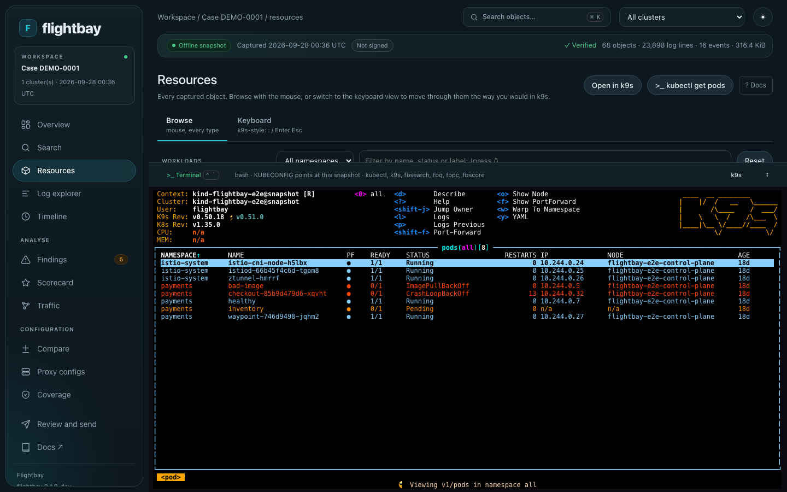
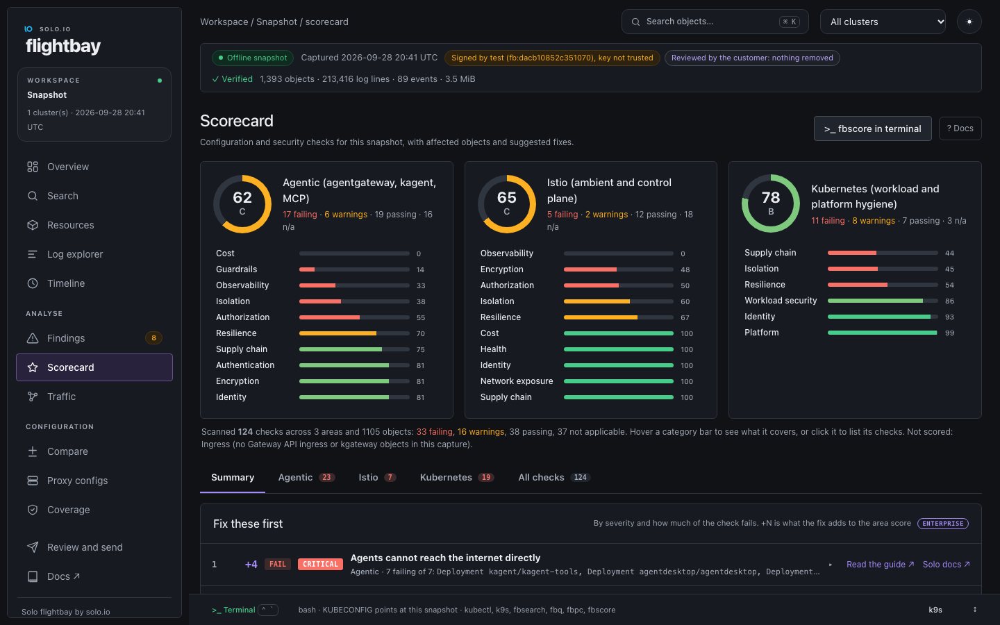

<p align="center">
  
</p>

<h1 align="center">Flightbay</h1>

<p align="center">
  <strong>Investigate a Kubernetes cluster you can't log in to.</strong><br>
  The customer runs one command and sends you a redacted file.<br>
  You open it on your laptop and work through it as if the cluster were live.
</p>

<p align="center">
  <a href="https://github.com/tjorourke/flightbay/releases/latest"></a>
  <a href="https://github.com/tjorourke/flightbay/actions/workflows/ci.yml"></a>
  <a href="LICENSE"></a>
</p>

<p align="center">
  <a href="#install">Install</a> ·
  <a href="#quick-start">Quick start</a> ·
  <a href="#what-it-is">What it is</a> ·
  <a href="#guides">Guides</a>
</p>


> **Safe to send.** Flightbay only reads from the cluster, redacts credentials in memory, never collects Secret values or uploads anything, and can sign and encrypt every bundle.

## Install

On macOS, with Homebrew:

```bash
brew tap tjorourke/flightbay https://github.com/tjorourke/flightbay
brew install flightbay
```

<sub>If Homebrew asks you to trust the formula, run <code>brew trust --formula tjorourke/flightbay/flightbay</code> and install again.</sub>

That gives you the collector, `flightbay`, and the desk, `flightbay-desk`. On Linux and Windows, download them from the [latest release](https://github.com/tjorourke/flightbay/releases/latest) (the desk runs on macOS and Linux). Whoever captures the cluster only needs `flightbay`. Upgrades and other options are in [Install and upgrade](https://github.com/tjorourke/flightbay/blob/main/docs/install.md).

## Quick start

```bash
flightbay collect --context my-cluster --dry-run   # what it would read, and the RBAC it needs
flightbay collect --context my-cluster             # writes flightbay-<time>.tar.zst
flightbay ui .                                     # opens the newest capture in your browser
```

No cluster to hand? Open the sample, a small Istio ambient cluster with five faults planted in it:

```bash
curl -LO https://github.com/tjorourke/flightbay/raw/main/examples/sample-bundle.tar.zst
flightbay ui sample-bundle.tar.zst
```

## What it is

Flightbay has two parts. The collector, `flightbay`, is a single static binary that reads the namespaces you choose and writes one redacted `.tar.zst` file. The desk, `flightbay-desk`, opens that file as a local workspace, so nobody needs access to the cluster to investigate it.

<table>
  <tr>
    <td width="50%" valign="top">
      <br>
      <strong>Every log line, searchable.</strong> Zoom into a spike, then follow a trace across pods.
    </td>
    <td width="50%" valign="top">
      <br>
      <strong>kubectl and k9s on the snapshot.</strong> Each cluster shows up as <code>&lt;context&gt;@snapshot</code>, and changes are refused.
    </td>
  </tr>
  <tr>
    <td width="50%" valign="top">
      <br>
      <strong>Scorecard.</strong> Security and operational checks for Kubernetes, Istio, agentgateway, kagent and kgateway, each with the YAML that fixes it.
    </td>
    <td width="50%" valign="top">
      <br>
      <strong>Agent reach.</strong> What every AI agent can get to, the internet included, and the policy that locks it down.
    </td>
  </tr>
</table>

The desk also shows the config Envoy, ztunnel and agentgateway had loaded, mirrors a live cluster read-only, compares two captures, scans a Git repository before anything is deployed, and gives AI agents the workspace over MCP.

## Guides

| Guide | What's in it |
|---|---|
| [Capture a cluster](https://github.com/tjorourke/flightbay/blob/main/docs/collect.md) | Send a bundle to support, choose what is collected, review, sign and encrypt it |
| [Investigate a bundle](https://github.com/tjorourke/flightbay/blob/main/docs/desk.md) | Search, logs, findings, the Scorecard, the terminal, live clusters and MCP |
| [Istio ambient](https://github.com/tjorourke/flightbay/blob/main/docs/ambient.md) | Attachment maps, waypoints and guided changes with dry-run and undo |
| [Flightbay Enterprise](https://github.com/tjorourke/flightbay/blob/main/docs/enterprise.md) | Agent reach, the Traffic map, gateway calls and fix-first priorities |
| [Scan a repository](https://github.com/tjorourke/flightbay/blob/main/docs/scan.md) | Score manifests, Helm charts and Kustomize overlays before they ship, and gate CI |
| [Commands](https://github.com/tjorourke/flightbay/blob/main/docs/commands.md) | Every command, and how the bundle, collector and desk work |
| [What is collected](https://github.com/tjorourke/flightbay/blob/main/docs/COLLECTS.md) | Everything the collector reads and never reads, generated from its code |
| [Contributing](https://github.com/tjorourke/flightbay/blob/main/CONTRIBUTING.md) | Build from source, run the tests, open a pull request |

The full documentation ships inside the desk and works offline: press **Docs** in the sidebar.

## Licence

Flightbay is in active development and licensed under the Apache License 2.0. See [LICENSE](LICENSE).
