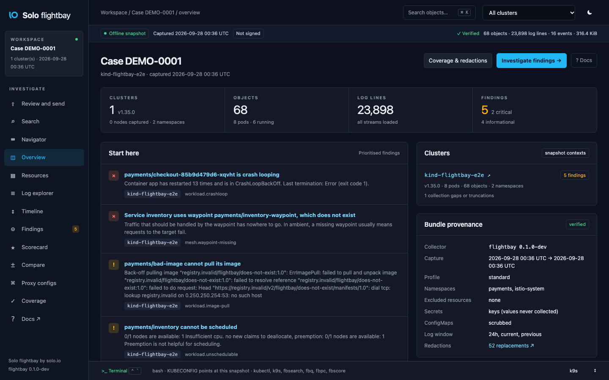
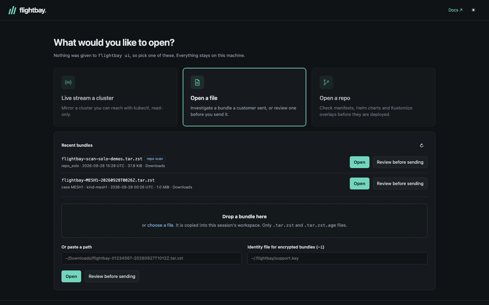
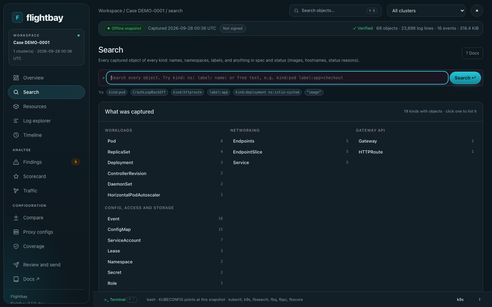
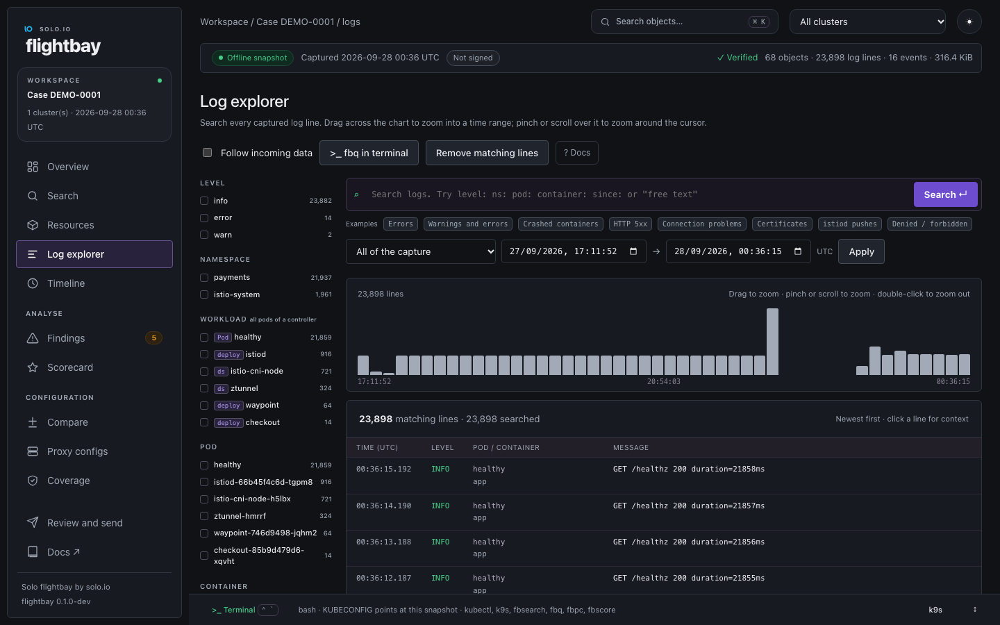
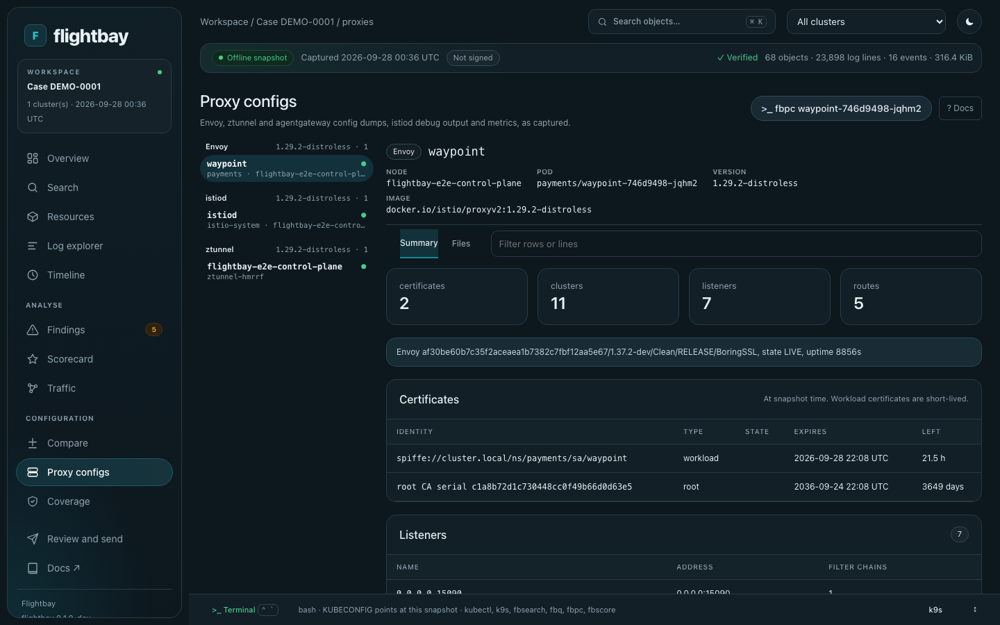
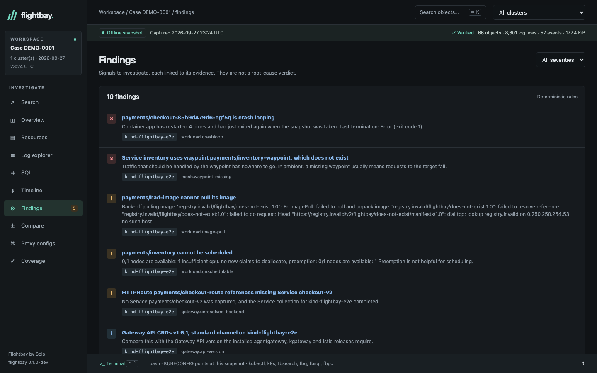
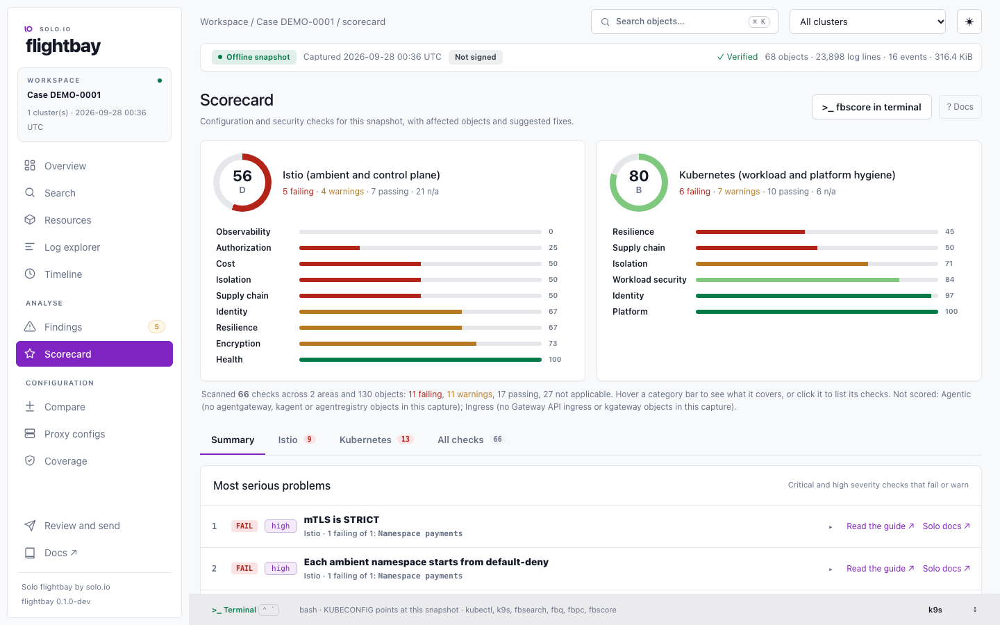
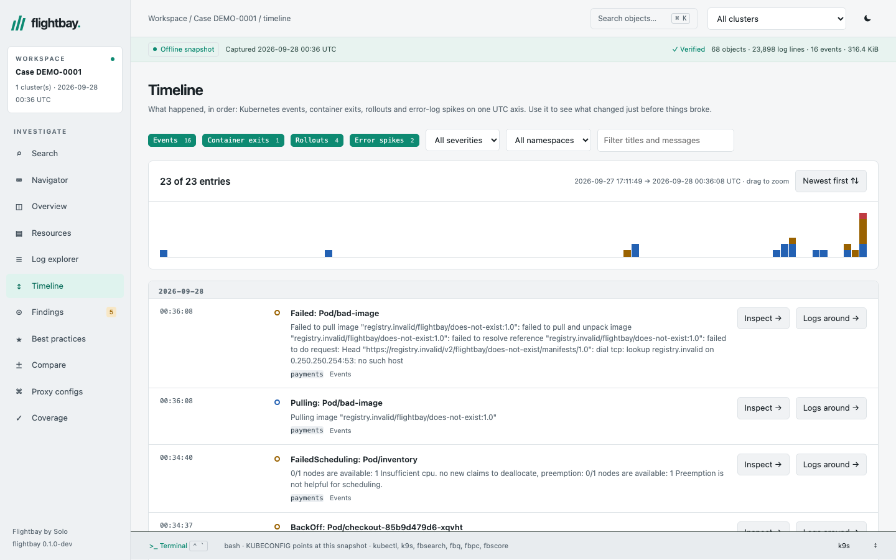

# Flightbay by Solo

Flightbay takes a redacted snapshot of a Kubernetes cluster and lets you investigate it offline as if it were live. You can browse every object, search every log line, run `kubectl` and `k9s` against it, read the Envoy, ztunnel and agentgateway config dumps, and get findings that know about Istio ambient, agentgateway and kgateway.



It is two commands:

```bash
flightbay collect --context my-cluster      # capture: writes flightbay-<time>.tar.zst
flightbay ui .                              # open the newest capture here in your browser
```

Run `flightbay ui` with no arguments and it opens a start page instead, with three cards: **Live stream a cluster** (pick a kubeconfig context, preview what will be read and the RBAC it needs, then mirror it read-only), **Open a file** (captures in this directory and `~/Downloads` are listed; open one, or review it before you send it; drag and drop works too) and **Open a repo** (a directory or a Git URL, scanned for manifests, Helm charts and Kustomize overlays). The footer shows the command line for whatever you pick, so you can skip the page next time.



## Install

From source (Go 1.27, and a C compiler for the UI, which embeds DuckDB):

```bash
git clone https://github.com/tjorourke/flightbay && cd flightbay
make install                  # installs flightbay and flightbay-desk into $(go env GOPATH)/bin
```

Make sure `$(go env GOPATH)/bin` is on your `PATH`. Release builds (Homebrew, `kubectl flightbay` through krew, and a container image) are set up in `.goreleaser.yaml` and `.github/workflows/release.yml`.

## Try it with the sample

`examples/sample-bundle.tar.zst` is a capture of a small kind cluster running Istio ambient, a waypoint and a shop app with faults planted in it: a crash loop, an image that won't pull, a pod that can't be scheduled, a route to a missing Service and a Service pointing at a waypoint that doesn't exist.

```bash
flightbay ui examples/sample-bundle.tar.zst
```

Your browser opens on the workspace. If it doesn't, open the `UI:` address it prints, token included. The button at the top right switches between light and dark. Press Ctrl+C in the terminal to close it; the workspace is deleted when you do.

Things to try:

- **Findings.** The five planted faults, each with its evidence and a next step.
- **Search.** `checkout`, `kind:pod CrashLoopBackOff`, `label:app=checkout`, `"registry.invalid"`.
- **Log explorer.** Click the **Errors** example, drag across the chart to zoom into a spike, then click a line and follow its `trace_id` across pods.
- **Proxy configs.** The waypoint's listeners, clusters, routes and certificates, istiod's view of which proxies are in sync, and ztunnel's workloads.
- **k9s.** Press **Open in k9s** on Resources, or **k9s** in the terminal bar.
- **Terminal.** Open it at the bottom (Ctrl+\`) and run `k get pods -n payments`, `k logs`, `k9s`, `fbsearch` or `fbq`.

## Capture a cluster

```bash
flightbay collect --context mesh1 --dry-run            # what it would read, and the RBAC it needs; reads nothing else
flightbay collect --context mesh1                      # capture everything the default profile allows
flightbay collect --context mesh1 --namespaces payments,istio-system --since 2h --case 01234567
flightbay collect --context mesh1 --solo-diagnostics   # add proxy config dumps, istiod debug output and metrics
flightbay inspect flightbay-*.tar.zst --redactions     # check what's in it before you share it
```

The default `standard` profile collects objects, events, the last 24 hours of logs (up to 20 MiB per container, newest kept) and Helm release summaries from every namespace it can read. Useful options:

| Option | What it does |
|---|---|
| `--namespaces`, `--exclude-namespaces` | Limit the capture (globs work: `team-*`) |
| `--since 2h`, `--max-log-bytes 10485760`, `--no-logs` | Control log volume |
| `--exclude-resources configmaps,secrets` | Never read these types |
| `--include-resources pods,httproutes.gateway.networking.k8s.io` | Read only these types (exclusions still win) |
| `--drop-field 'metadata.annotations["corp.example/*"]'` | Remove a field from every object before writing |
| `--sign flightbay-signing.key` | Sign the bundle with your key (`flightbay keygen`) |
| `--config policy.yaml --policy-key approver.pub` | Only run with a policy your security team signed (`flightbay policy sign`) |
| `--solo-diagnostics` | Also read the admin endpoints of ztunnel, Envoy, agentgateway, istiod and gateway controllers through port-forward |
| `--cluster-scoped` | Also capture nodes, CRDs and other cluster-wide objects |
| `--profile minimal` | Object metadata and events only |
| `--encrypt-to age1...` | Encrypt the bundle so only the matching key can open it |
| `--context a,b` | Several clusters in one bundle |
| `-o -` | Stream to stdout, e.g. `flightbay collect -o - \| flightbay-desk open -` |

`flightbay rbac` prints least-privilege RBAC for the same options, so the collector can run with only what it needs.

### What is and isn't collected

Secret values are never collected: Secrets become names, types, labels and key names. Credentials in object specs, environment variables, ConfigMaps, logs and proxy dumps are replaced before anything is written. That includes JSON embedded inside a field, such as `kubectl.kubernetes.io/last-applied-configuration`. `redaction-report.json` counts what was replaced, and never records the values. [docs/COLLECTS.md](docs/COLLECTS.md) lists everything, and a test regenerates it from the collector's own code so the two can't drift apart.

When you limit namespaces, proxy and control-plane dumps are filtered as well. ztunnel, agentgateway and istiod describe the whole mesh, so any entry that names another namespace is removed before it's written, and the bundle records how many were removed.

### Decide what to send, and sign it

```bash
flightbay keygen --name "ACME platform team"                     # flightbay-signing.key stays with you; send Solo the .pub
flightbay ui flightbay-*.tar.zst --sign flightbay-signing.key --encrypt-to age1...
```

Every bundle you open in the UI has a **Review and send** page, and a **Remove from the bundle** button on each object. Take out whole namespaces, resource types, single objects, log streams or lines, proxy dumps and flow files, add redaction patterns, and see exactly what Solo will receive before you export. The export is a new bundle, signed with your key, with `review-ledger.json` counting what was removed (names only if you choose to list them). Solo's desk shows "Signed by ACME platform team, unmodified" and marks checks that need removed data as not applicable instead of failing them. `flightbay review BUNDLE --plan review.yaml` runs the same removals without the UI. See [Reviewing before you send](docs/site/content/collect/review.md) and [Signing and approved policies](docs/site/content/collect/signing.md).

One thing is deliberately left out. The agentgateway and kgateway controllers are built on a library called krt, which keeps an in-memory copy of every Kubernetes object the controller watches. That includes Gateways, routes and policies, but also the Secrets it reads, such as TLS keys and API keys for LLM providers. The controller's admin port can dump all of that as one large JSON document. It would be useful for debugging the controller, but it covers every namespace and contains Secret values, so it can't respect "only these namespaces" or "never Secret values". Flightbay collects the controllers' logs, metrics and the objects themselves instead.

## Find things



**Search** covers every captured object of every kind: names, namespaces, labels and anything in spec and status, such as images, hostnames and status reasons. ⌘K jumps to an object from anywhere.

```text
checkout                          name, label or content
kind:pod ns:payments              kind accepts short names: po, svc, deploy, httproute
label:app=checkout   name:ist*    labels and name prefixes
"CrashLoopBackOff"   -kind:event  phrases, and - to exclude
```

**Log explorer** searches every log line, like Kibana or OpenSearch Dashboards:

- **Time.** Drag across the chart with your trackpad or mouse to zoom into a range, and keep dragging to drill down. Pinch or scroll over the chart to zoom around the cursor, and double-click to zoom out. There are quick ranges ("last 15 minutes of the capture"), exact from/to times, and **Whole capture** to reset.
- **Fields.** The left panel lists level, namespace, pod (with a search box), container and stream, and then the fields parsed from the logs, such as `trace_id`, `status`, `method`, `path`, `src.workload` and `dst.addr`, each with its most common values. Click a value to filter on it.
- **Examples** above the search box: errors, crashed containers, HTTP 5xx, connection problems, certificates, istiod pushes, and denied requests.
- **Context.** Click a line to see the lines around it in the same container, and follow its trace, request or connection ID across pods.

```text
level:error ns:payments "timed out"    pod:checkout*    trace_id:a4e98f02    status:5*    stream:previous    since:15m    -healthz    a OR b
```



**Proxy configs** shows what each Envoy, ztunnel and agentgateway had loaded when the snapshot was taken: listeners, routes, clusters, endpoints, workloads, policies and certificates. For istiod it shows which proxies are in sync.



**Findings** runs rules over the snapshot: crash loops, image pulls, scheduling failures, routes and policies that weren't accepted, missing backends and waypoints, istio-cni not ready, proxies that haven't picked up config, NACKs, expiring certificates, version skew and repeated error messages. They point you at the evidence; they aren't a verdict. A rule that depends on something being missing waits until that data has fully loaded, and never fires on data the customer chose not to collect.



**Scorecard** scores the snapshot against Solo's best practices: 130 checks (135 with Agent reach) drawn from the Solo field guides, the agentgateway, kagent, Istio and kgateway source, and Kubernetes hardening guidance, in four areas:

- **Agentic**: MCP and A2A endpoints without authentication, optional API-key modes, client tokens passed through to MCP servers, missing tool allowlists, code mode without limits, guardrails that fail open, LLM spend without a budget, credentials held inline or pointing at Secrets that don't exist, policies that weren't accepted, and agents that bypass the gateway.
- **Istio**: namespace enrolment, pods ztunnel isn't capturing, STRICT mTLS, default-deny, principals in the wrong trust domain, L7 policy that nothing enforces, ingress that skips the waypoint, istiod HA, plugged-in CA, multicluster peering and remote secrets, and exposed control-plane ports.
- **Ingress**: listeners without TLS, certificate Secrets that are missing or not granted, cross-namespace references without a ReferenceGrant, shared gateways open to every namespace, client IP policy that sees the wrong address, and kgateway auth that fails open.
- **Kubernetes**: privileged pods and host access, capabilities (knowing what ztunnel and istio-cni legitimately need), RBAC wildcards and cluster-admin bindings, Pod Security Admission, NetworkPolicy, exposed Services, requests, probes, replicas and PDBs, unpinned images, supported versions, failed Helm releases and expiring certificates.

**Flightbay Enterprise** adds a priority view: severity tags coloured by weight, a **Fix these first** list ranked by severity and how much of each check fails, and the area score each fix gives back ("+7"). `fbscore --top 10` prints the same ranking, and the MCP `best_practices` tool returns it as `priorities`. Turn it on for the desk with `FLIGHTBAY_ENTERPRISE=1 flightbay ui` (or `FLIGHTBAY_FEATURES=priorities`); `flightbay-desk features` lists what is on.

The page opens on the score per area, then tabs: Summary (the most serious problems), one tab per area, and All checks. Only problems are listed by default, with a line saying how many checks ran. Each check lists the objects it looked at, says why it matters and gives the YAML to fix it, with a link to the matching guide on mastertheagent.com or masterthemesh.com. Checks are weighted by severity. A check whose data wasn't collected, or that has nothing to apply to, is marked not applicable and doesn't count against the score.



**Agent reach (Flightbay Enterprise)** lists every kagent agent, MCP server, agentgateway and workload that looks like an agent, worst first, with its blast radius (open, wide, narrow or contained), whether it can reach the internet, how many Services it reaches directly and in any number of hops, and how many it can write to. Pick one to see a left-to-right graph of what it reaches and what those destinations reach for it, the paths that lead out to the internet or cloud metadata, findings with the YAML to fix each one, the identity it carries (service account, token, RBAC, Secrets, host access) and a table of every destination with its verdict, methods, and whether the capture shows it being called. It is built for the OpenAI and Hugging Face incident, where agents got to the internet through a package registry they were allowed to call, which accepted writes and fetched URLs for them. Turn it on with `FLIGHTBAY_ENTERPRISE=1 flightbay ui` (or `FLIGHTBAY_FEATURES=reach`); `fbreach` in the terminal and the MCP `agent_reach` tool give the same answer, and the Scorecard gains five agentic checks built on it. It covers destinations outside the cluster too (the incident's registry was an external JFrog): every external host an agent is configured for or was seen calling, how it is reached, and the credentials it holds for it. Observed traffic comes from ztunnel, agentgateway, Envoy and CoreDNS logs in the capture, and from Hubble, Calico, AWS, GCP or Azure flow logs, or any CSV or JSON flow export, attached with `flightbay collect --attach-flows` or `flightbay-desk open --flows`. Every destination says how it was found (the policy verdict, the agent's configuration, a gateway route, and each flow source that saw it) and can be filtered on that; open one to see the policy reasons, where it is configured, the flow records themselves with the file or logs each came from, and a link to the matching log lines. `test/e2e/reach.sh` recreates the incident on kind, proves the agent can PUT to the registry and reach the internet, applies the fixes Flightbay generated, and proves both are blocked afterwards.

**Timeline** puts Kubernetes events, container exits, rollouts and bursts of error logs on one UTC axis, so you can see what changed just before things broke. Filter by kind, severity and namespace, drag across the density strip to zoom into a window, and jump from any entry to the object or to the logs around that moment. A steady run of errors shows as one entry covering its time range, and a minute well above that run's usual rate is called out on its own.



**Compare** shows what changed between two captures of the same cluster: objects added, removed or changed, image upgrades, and findings that appeared or went away. Pick an earlier bundle from the list (Flightbay looks next to the open bundle, in the current directory and in `~/Downloads`) or paste a path. For a capture of several clusters it also compares one object across them.

Search boxes complete as you type from what is in the capture: `kind:` lists the kinds that have objects, `label:` lists label keys and then their values, `ns:` in the log explorer lists namespaces with lines matching the rest of the query. The timeline, best practices, navigator and resources filters do the same.

### From the terminal

`kubectl` (or `k`), `k9s` and `stern` work against the snapshot. Each cluster appears as `<context>@snapshot`, and changes are refused.

```bash
flightbay-desk shell                          # a shell wired to the open workspace (or use the UI's terminal)
k get pods -A                                 # k is kubectl, with tab completion
k describe pod -n payments checkout-85b9d479d6-cgf5q
k logs -n payments deploy/checkout --previous
k9s
fbsearch 'kind:pod CrashLoopBackOff'          # object search
fbq 'level:error ns:payments'                 # log search
fbsql "SELECT namespace, pod, count(*) FROM logs WHERE level = 'error' GROUP BY ALL"   # read-only DuckDB SQL; fbsql alone for a prompt
fbpc                                          # captured proxies; fbpc <pod> for one, --file config_dump.json for raw
fbfind                                        # findings
fbscore                                       # best-practice scores, failing checks and their fixes
```

### Watch a live cluster

With kubectl access, the desk can mirror a cluster live instead of opening a capture. It lists and watches every type in scope, follows logs, and keeps the UI, the Navigator, search, the Scorecard and Agent reach up to date. It only ever reads (a transport guard refuses anything but GET), and **Save as bundle** writes the current mirror as a normal verified bundle.

```bash
flightbay ui --live --context prod-eu --namespaces 'kagent,agentgateway-system,istio-system'
```

### Compare two captures

```bash
flightbay-desk diff before.tar.zst after.tar.zst       # objects added, removed and changed, image changes, new and resolved findings
flightbay ui after.tar.zst --baseline before.tar.zst   # the same, in the Compare view
```

An object only counts as removed if both captures covered its type and namespace. Anything else is reported as not comparable.

### Scan a repository instead of a cluster

```bash
flightbay scan deploy/ --env prod                                   # manifests, Helm charts, Kustomize overlays, Argo CD and Flux sources
flightbay scan . --fail-on high --new-only --base-ref origin/main --format sarif -o flightbay.sarif   # CI gate
flightbay-desk drift repo-scan.tar.zst cluster.tar.zst              # in Git and not running, running and not in Git, fields changed by hand
```

`flightbay scan` renders what a repository declares into a normal bundle marked `source: repo`, so the desk, the Scorecard and Agent reach work on it. Checks that need a running cluster say "declared state only (repo scan)" instead of failing. `examples/ci/` has GitHub Actions and GitLab CI workflows. See the [scan docs](docs/site/content/scan/_index.md).

### AI agents

`flightbay-desk mcp` makes the open workspace available to AI agents over MCP. The tools are read-only: search objects and logs, read-only SQL, findings, best-practice scores, objects and proxy configs, plus a `triage` prompt for a guided investigation.

```bash
claude mcp add flightbay -- flightbay-desk mcp
```

The MCP server only talks to your local workspace. Snapshot data reaches a model only if the agent you connect uses a hosted one.

## Commands

| Command | |
|---|---|
| `flightbay collect` | Capture a cluster (alias `capture`) |
| `flightbay scan [PATH...]` | Build a bundle from a code repository and score it; `--fail-on` makes it a CI gate |
| `flightbay ui [bundle \| dir]` | Open the UI on a capture, or the newest in a directory; no arguments opens the start page (live, a file or a repo) |
| `flightbay inspect BUNDLE` | Verify a bundle and show what's in it; `--verify-key` checks the signature |
| `flightbay review BUNDLE --plan FILE` | Remove objects, logs and namespaces from a bundle without the UI and export a signed copy (in the UI it is the Review and send page) |
| `flightbay keygen` | Create an Ed25519 signing key pair |
| `flightbay policy sign / verify` | Approve a collection policy file, and check an approval |
| `flightbay extract BUNDLE DIR` | Verify and unpack it (it's also a normal `tar.zst`: `tar --zstd -xf`) |
| `flightbay rbac` | Least-privilege RBAC for your options |
| `flightbay docs collects` | What is and isn't collected |
| `flightbay-desk open` | What `flightbay ui` runs; `--keep` keeps the workspace, `-i key` opens encrypted bundles |
| `flightbay-desk start` | The start page that `flightbay ui` with no arguments opens |
| `flightbay-desk search / query / findings / proxy-config / sql / posture` | The terminal helpers (`fbsearch`, `fbq`, `fbfind`, `fbpc`, `fbsql`, `fbscore`), usable anywhere a workspace is open |
| `flightbay-desk diff A B` | Compare two captures |
| `flightbay-desk drift REPO CLUSTER` | Compare a repo scan with a capture |
| `flightbay-desk mcp` | MCP server for agents |
| `flightbay-desk features` | Flightbay Enterprise features and whether they are on |
| `flightbay-desk keygen` | Create an age key pair for `--encrypt-to` |

## How it works

- **The bundle** is a plain `tar` stream compressed with zstd. `bundle.json` comes first, with the capture policy; `manifest.json` comes last, with a SHA-256 for every file, followed only by `manifest.sig` when the bundle is signed. Logs are written early and bulky diagnostics late, so the UI can open before the file has finished reading.
- **The collector** is a single static Go binary with no dependencies. It redacts in memory and never writes unredacted data to disk.
- **The UI** (`flightbay-desk`) stores logs, objects and events in DuckDB in a temporary workspace. It keeps about 90 bytes per log line on disk: 10 million lines is 0.8 GB and loads in about 35 seconds. Searching 10 million lines takes 20–250 ms for structured queries and under a second for free text. It also serves a read-only Kubernetes API, which is what `kubectl` and `k9s` talk to.

## Development

```bash
make build                                    # ./bin/flightbay and ./bin/flightbay-desk
make test                                     # unit tests
test/e2e/e2e.sh                               # kind cluster with planted faults: collector, UI, kubectl, k9s, search, SQL
MESH_CONTEXT=kind-mesh1 test/e2e/mesh.sh      # Solo diagnostics against an existing ambient cluster (read-only)
test/e2e/reach.sh                             # agent reach on kind + Istio ambient: applies the generated fixes, proves traffic blocked (make e2e-reach)
FLIGHTBAY_SCALE=10000000 go test ./internal/store -run TestScale -v -timeout 60m
docker build -t flightbay-desk .              # UI image with kubectl, k9s, istioctl, stern, jq and yq
```

## Status

Early and unreleased. Still to decide: the licence, and who owns the key customers encrypt bundles to.
