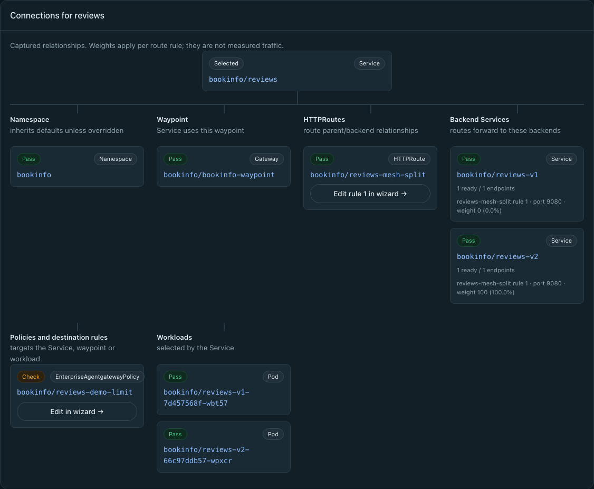
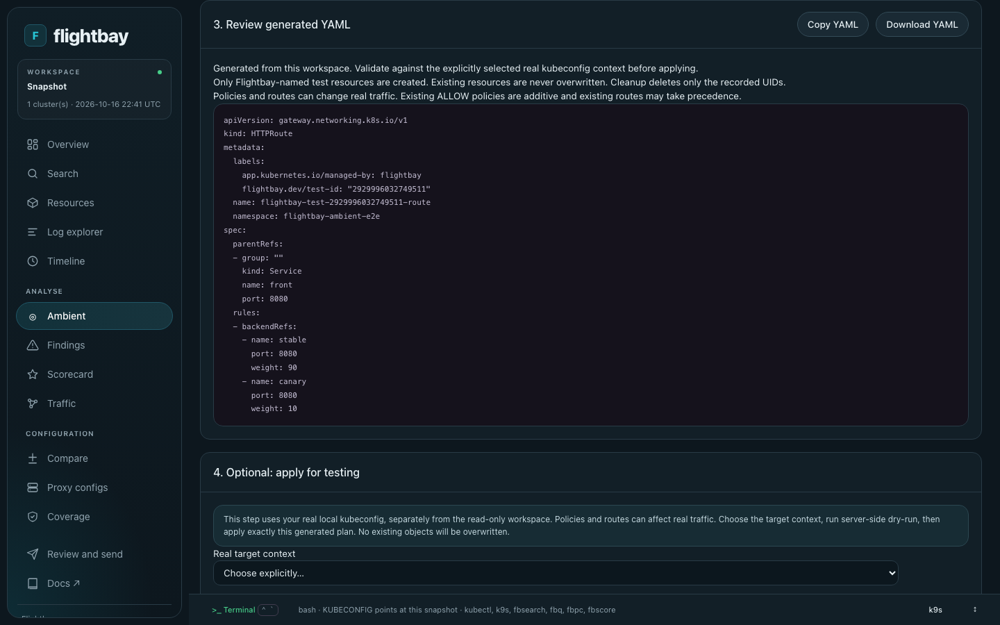
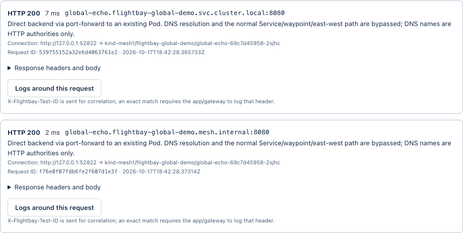

# Istio ambient

The **Ambient** page investigates and configures Istio ambient from a capture or a live cluster. It appears when the captured Istio APIs and evidence of an ambient installation are in the selected cluster scope.

## What you can do

- **Investigate.** Search Namespace, Service, Pod, Gateway, HTTPRoute and ServiceEntry entry points, and follow failed checks into an evidence-aware recovery wizard.
- **Change.** Edit captured routing weights and policies, or set up shared waypoints.
- **Apply safely.** Preview the YAML and field diffs, dry-run, then confirm Apply to an explicitly selected real context. Scoped test changes can be undone.

Configuration runs **Target → Task → Configure → Review**, with **Clear selection** and **New configuration** controls. Detected controller and API evidence selects the matching OSS or Enterprise policy shape, and labelled **Official docs** links accompany tasks and debugging steps.

## The attachment map

Namespace maps show every captured Service and its endpoint counts. The map groups Services inside draggable, expandable cluster-context boxes with Kubernetes icons and independent card and list views. Captured east-west peering and global-Service publications have evidence-backed connection lines. Zoom, pan, fit, reset or go full screen; the top search focuses resources on the map, and **View object** and **View YAML** open the actual resources. Multicluster bundles show every captured context without assuming that the clusters are peered.

## Global services

Service cards show cluster and published global DNS names. Configure generates independent global-publication label patches for selected clusters where the matching Service already exists, with separate contexts, dry-runs and status. Apply requires confirmation of the actual contexts, API servers and YAML, and successful changes can be undone.

## Testing a service

**Test service** runs saved HTTP-header profiles from the desk host, directly or through a temporary port-forward to existing Pods, and links response results to the matching log time window. **Back to HTTP test** restores the originating map or wizard, profile and results without rerunning the request. No test Pods are deployed. Investigation status badges filter the checks.

More detail: [Ambient investigation and configuration](site/content/desk/ambient.md).
