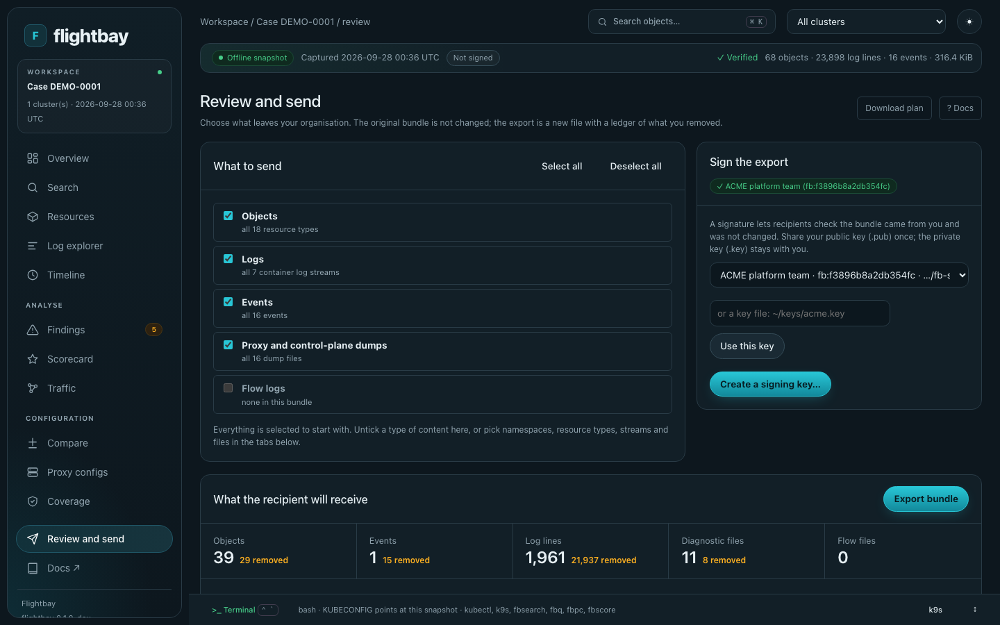

# Capture a cluster

`flightbay collect` (alias `capture`) reads the namespaces you choose and writes one bundle file. It only reads, so nothing in the cluster is created, changed or deleted. Credentials are redacted in memory before anything is written, Secret values are never collected, and Flightbay never uploads the file: you choose how to share it.

- [Send a capture to support](#send-a-capture-to-support)
- [Common commands](#common-commands)
- [Options](#options)
- [What is and isn't collected](#what-is-and-isnt-collected)
- [Review, sign and encrypt](#review-sign-and-encrypt)

## Send a capture to support

The customer needs only the `flightbay` collector and their existing kubeconfig access. [Install](install.md) it with Homebrew, or download the `flightbay_<version>_<os>_<arch>` archive and extract it into a working directory. The examples below use `./flightbay` for an extracted binary; use `flightbay` for a Homebrew installation. In PowerShell, use `.\flightbay.exe` and put the command on one line.

### On the customer's machine

Replace `my-cluster` with the kubeconfig context and `payments,istio-system` with the namespaces to share:

```bash
./flightbay collect \
  --context my-cluster \
  --namespaces payments,istio-system \
  --collect objects \
  --no-logs \
  --no-portforward \
  --out flightbay-objects.tar.zst
```

This collects the Kubernetes objects in those namespaces, with credentials redacted and Secret values omitted. It leaves out logs, events, Helm summaries, proxy dumps and cluster-wide resources such as Nodes. API discovery, metadata for the selected Namespaces and selected CRD definitions are kept so the desk can interpret the objects. Most CRD schemas are omitted; HTTPRoute keeps its schema for installed routing capability checks. Objects are stored as JSON API representations, rather than individual YAML files.

For a capture that also includes logs and events, drop `--collect objects` and `--no-logs`. Proxy diagnostics still need `--diagnostics`. Add `--dry-run` to preview the plan without creating a file.

To check the archive before sending it:

```bash
./flightbay inspect flightbay-objects.tar.zst --contents --redactions
```

`inspect` verifies the archive. `--contents` lists its files and `--redactions` shows replacement counts by location and rule, never the original values. Redaction already happened during collection; this only shows the report. Object names, labels and other non-credential information stay in the capture, so use [Review and send](#review-sign-and-encrypt) if you need to remove more.

Send `flightbay-objects.tar.zst` through your agreed support channel. It is a zstd-compressed tar archive: there is no need to unpack it or send a kubeconfig.

### On the recipient's machine

Install `flightbay-desk` from the same release, then open the file you received:

```bash
flightbay-desk open flightbay-objects.tar.zst
```

The desk verifies and opens the archive in a local browser UI. It needs no access to the customer's cluster. With both binaries installed, `flightbay ui flightbay-objects.tar.zst` opens the same desk. An objects-only capture supports resource browsing, search and checks based on the captured objects; the log and proxy views need those categories to have been collected. See [Investigate a bundle](desk.md).

## Common commands

```bash
flightbay collect --context mesh1 --dry-run            # what it would read, and the RBAC it needs; reads nothing else
flightbay collect --context mesh1                      # capture everything the default profile allows
flightbay collect --context mesh1 --namespaces payments,istio-system --since 2h --case 01234567
flightbay collect --context mesh1 --diagnostics        # add proxy config dumps, istiod debug output and metrics
flightbay inspect flightbay-*.tar.zst --redactions     # check what's in it before you share it
```

The default `standard` profile collects objects, events, the last 24 hours of logs (up to 20 MiB per stream, newest kept) and Helm release summaries from every namespace it can read.

## Options

| Option | What it does |
|---|---|
| `--namespaces`, `--exclude-namespaces` | Limit the capture (globs work: `team-*`) |
| `--since 2h`, `--max-log-bytes 10485760`, `--no-logs` | Control log volume |
| `--exclude-resources configmaps,secrets` | Never read these types |
| `--include-resources pods,httproutes.gateway.networking.k8s.io` | Read only these types (exclusions still win) |
| `--concurrency 4`, `--log-concurrency 8`, `--log-qps 50` | How much is read in parallel; lower them on a busy production cluster ([Large clusters](site/content/collect/large-clusters.md)) |
| `--drop-field 'metadata.annotations["corp.example/*"]'` | Remove a field from every object before writing |
| `--sign flightbay-signing.key` | Sign the bundle with your key (`flightbay keygen`) |
| `--config policy.yaml --policy-key approver.pub` | Only run with a policy your security team signed (`flightbay policy sign`) |
| `--diagnostics` | Also read the admin endpoints of ztunnel, Envoy, agentgateway, istiod and gateway controllers through port-forward |
| `--cluster-scoped` | Also capture nodes, CRDs and other cluster-wide objects |
| `--profile minimal` | Object metadata and events only |
| `--encrypt-to age1...` | Encrypt the bundle so only the matching key can open it |
| `--context a,b` | Several clusters in one bundle |
| `-o -` | Stream to stdout, e.g. `flightbay collect -o - \| flightbay-desk open -` |

`flightbay rbac` prints least-privilege RBAC for the same options, so the collector can run with only what it needs. [Collect examples](site/content/collect/examples.md) has commands for one namespace, the agentic stack, Istio ambient, several clusters, sharing less and encrypting.

Deployments and ReplicaSets are separate Kubernetes resources, so exclude both if neither is wanted: `--exclude-resources deployments.apps,replicasets.apps`. For a bundle you already captured, open **Review and send → Objects**, filter by resource type, then choose **Deselect all**. The bulk action applies only to filtered rows and changes the exported copy, not the original.

## What is and isn't collected

Secret values are never collected: Secrets become names, types, labels and key names. Credentials in object specs, environment variables, ConfigMaps, logs and proxy dumps are replaced before anything is written. That includes JSON embedded inside a field, such as `kubectl.kubernetes.io/last-applied-configuration`. `redaction-report.json` counts what was replaced, and never records the values. [What is collected](COLLECTS.md) lists everything, and a test regenerates it from the collector's own code so the two can't drift apart.

When you limit namespaces, proxy and control-plane dumps are filtered as well. ztunnel, agentgateway and istiod describe the whole mesh, so any entry that names another namespace is removed before it's written, and the bundle records how many were removed.

One thing is deliberately left out. The agentgateway and kgateway controllers are built on a library called krt, which keeps an in-memory copy of every Kubernetes object the controller watches. That includes Gateways, routes and policies, but also the Secrets it reads, such as TLS keys and API keys for LLM providers. The controller's admin port can dump all of that as one large JSON document. It would be useful for debugging the controller, but it covers every namespace and contains Secret values, so it can't respect "only these namespaces" or "never Secret values". Flightbay collects the controllers' logs, metrics and the objects themselves instead.

## Review, sign and encrypt

```bash
flightbay keygen --name "ACME platform team"                     # flightbay-signing.key stays with you; share the .pub with the recipient
flightbay ui flightbay-*.tar.zst --sign flightbay-signing.key --encrypt-to age1...
```

Every bundle you open in the UI has a **Review and send** page, and a **Remove from the bundle** button on each object. Take out whole namespaces, resource types, single objects, log streams or lines, proxy dumps and flow files, add redaction patterns, and see what the recipient will receive before you export. The export is a new bundle, signed with your key, with `review-ledger.json` counting what was removed (names only if you choose to list them). Flightbay verifies the signature and marks checks that need removed data as not applicable instead of failing them. `flightbay review BUNDLE --plan review.yaml` runs the same removals without the UI.



With `--encrypt-to`, only the holder of the matching age identity can open the bundle. `flightbay-desk keygen` creates one and prints the recipient to hand out. There is no built-in shared recipient key, so get the recipient from whoever will open the bundle.

More detail: [Reviewing before you send](site/content/collect/review.md), [Signing and approved policies](site/content/collect/signing.md) and [Sending a bundle](site/content/collect/sending.md).
