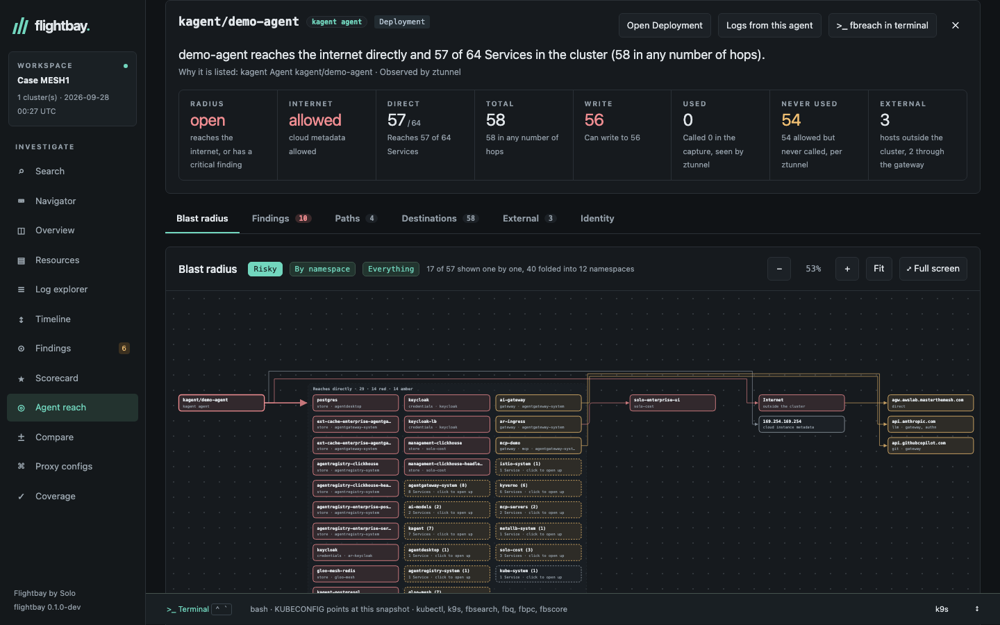
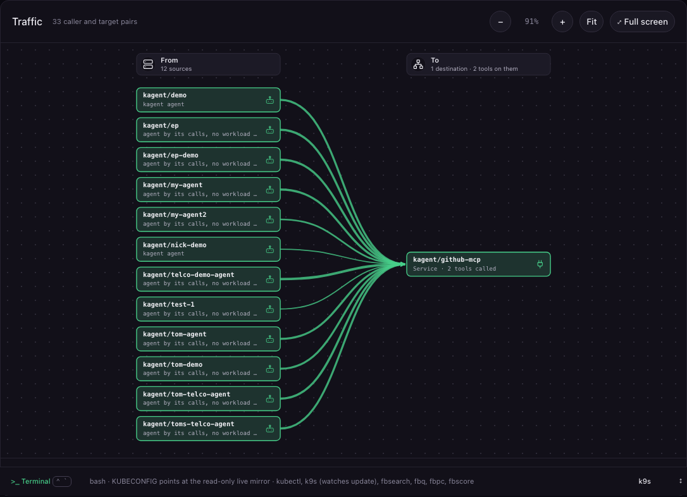

# Flightbay Enterprise

The collector and the desk work fully without Enterprise, and a customer never needs it to capture a bundle. Flightbay Enterprise adds four things to the desk. They are on by default.

- [Priorities](#priorities)
- [Agent reach](#agent-reach)
- [Gateway calls](#gateway-calls)
- [Traffic](#traffic)
- [Turning it off and agent mode](#turning-it-off-and-agent-mode)

## Priorities

The Scorecard gains a priority view: severity tags coloured by weight, a **Fix these first** list ranked by severity and how much of each check fails, and the area score each fix gives back ("+7"). `fbscore --top 10` prints the same ranking, and the MCP `best_practices` tool returns it as `priorities`.

## Agent reach

The **Agents** analysis lists every kagent agent, MCP server, agentgateway and workload that looks like an agent, worst first, with its blast radius (open, wide, narrow or contained), whether it can reach the internet, how many Services it reaches directly and in any number of hops, and how many it can write to.



Pick one to see a left-to-right graph of what it reaches and what those destinations reach for it, the paths that lead out to the internet or cloud metadata, findings with the YAML to fix each one, the identity it carries (service account, token, RBAC, Secrets, host access) and a table of every destination with its verdict, methods, and whether the capture shows it being called. It covers destinations outside the cluster too: every external host an agent is configured for or was seen calling, how it is reached, and the credentials it holds for it.

It is built for the OpenAI and Hugging Face incident, where agents got to the internet through a package registry they were allowed to call, which accepted writes and fetched URLs for them. `test/e2e/reach.sh` recreates the incident on kind, proves the agent can PUT to the registry and reach the internet, applies the fixes Flightbay generated, and proves both are blocked afterwards.

Observed traffic comes from ztunnel, agentgateway, Envoy and CoreDNS logs in the capture, and from Hubble, Calico, AWS, GCP or Azure flow logs, or any CSV or JSON flow export, attached with `flightbay collect --attach-flows` or `flightbay-desk open --flows`. Every destination says how it was found, and can be filtered on that. `fbreach` in the terminal and the MCP `agent_reach` tool give the same answer, and the Scorecard gains five agentic checks built on it.

## Gateway calls

Gateway calls, on the Traffic page, are what agents actually did through agentgateway, read from the gateway and waypoint request logs: who called which MCP tool, model or agent, resolved to a workload from the logged SPIFFE identity (or, without one, the address), with the JWT subject; how often; what was refused, with the reason and the agentgateway policies that produce it; what failed; and tokens and cost per model and caller. Called tools are checked against the tools each kagent MCP server lists and each declarative Agent's `toolNames`. With a baseline, tools that were added, removed or re-described (a rug pull) are listed. `fbactivity` and the MCP `agent_activity` tool give the same answer.

## Traffic

**Traffic** draws, on one map, the gateway calls above and every connection ztunnel logged between workloads and Services, with its transport (mutual TLS or plaintext), the waypoint that carried it, refusals, and the verdict of the captured NetworkPolicies and AuthorizationPolicies. It flags plaintext inside the mesh, traffic no policy looks at, and edges where the logs and the policy disagree.



**Why?** takes any workload and Service and shows every check in order (NetworkPolicy egress and ingress, mTLS, ztunnel L4 and waypoint L7 authorization) with the policy each read, what the logs saw, and the smallest YAML that would allow it. `fbtraffic`, `fbexplain` and the MCP `traffic_map` and `explain_connection` tools give the same answers.

## Turning it off and agent mode

```bash
flightbay-desk features                                     # what is on
FLIGHTBAY_FEATURES=-priorities flightbay ui                 # everything except priorities
FLIGHTBAY_ENTERPRISE=0 flightbay ui                         # none of them
```

`AGENT=1 flightbay ui --live --context CTX` opens agent mode, which trims the desk to Traffic, the agentic Scorecard and the views that support them.

These switches decide what the desk shows. They are not a security boundary.

More detail: [Flightbay Enterprise](site/content/enterprise/_index.md), [Agent reach](site/content/desk/agent-reach.md) and [Traffic](site/content/desk/traffic.md).
